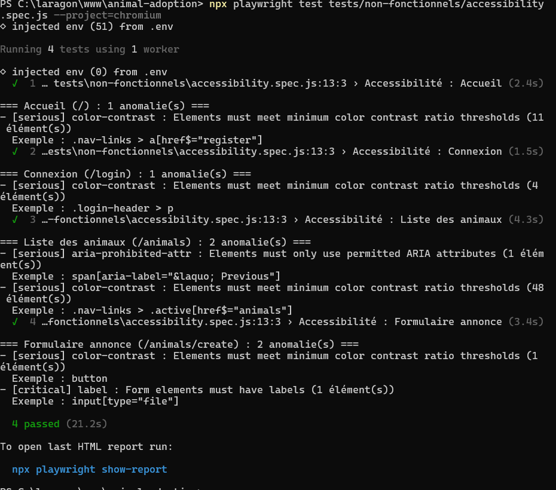
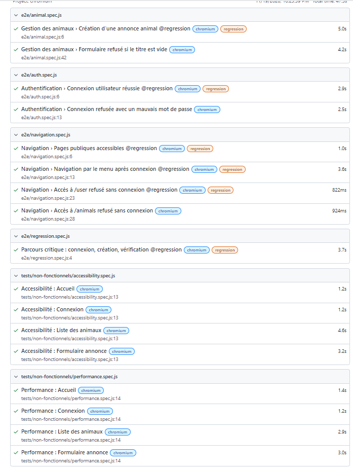
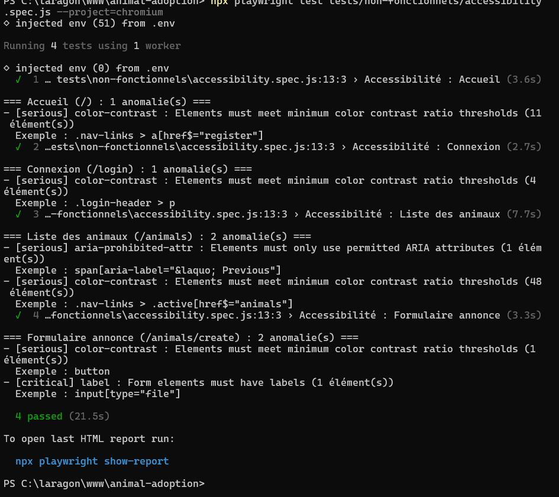
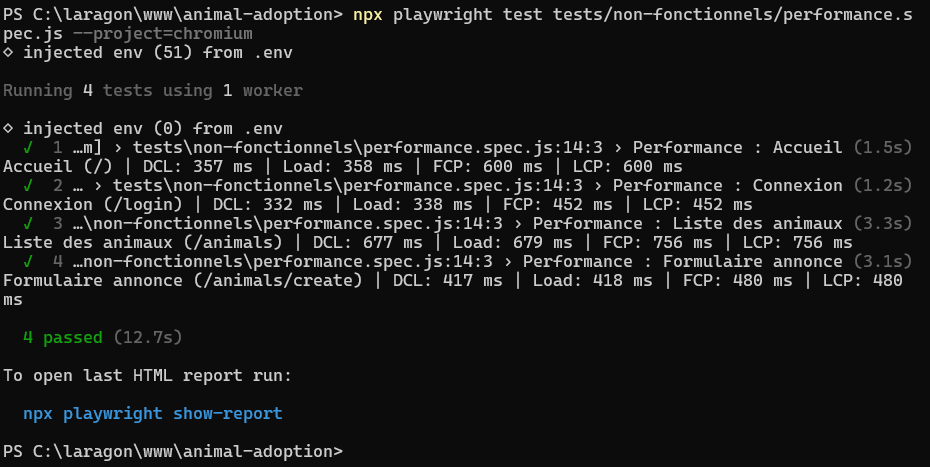
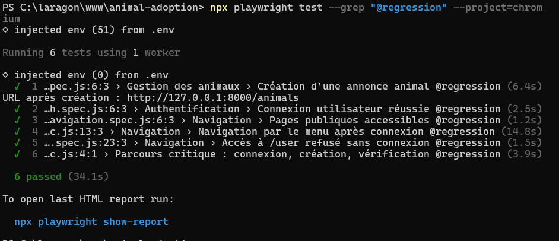

# Compte rendu – Semaine 9
**Projet :** Animal Adoption – Patte Douce
**Thème :** Interface et tests non fonctionnels

## 1. Objectif de la semaine
Valider l'interface de l'application par des tests E2E automatisés avec Playwright, réaliser des tests non fonctionnels (accessibilité, performance) et mettre en place une suite de régression.

## 2. Outils utilisés
- Playwright (tests E2E, navigateur Chromium)
- @axe-core/playwright (audit d'accessibilité WCAG 2.0 A / AA)
- Laravel / Laragon (`php artisan serve`), PowerShell, Git / GitHub
- Fichier `.env` pour les identifiants de test (non versionné)

## 3. Organisation du projet

```
e2e/
├── helpers/login.js
├── auth.spec.js
├── animal.spec.js
├── navigation.spec.js
└── regression.spec.js
tests/non-fonctionnels/
├── accessibility.spec.js
└── performance.spec.js
docs/09-semaine9/
├── rapport-accessibilite.md
├── rapport-performance.md
├── rapport-regression.md
└── preuves/ (captures)
playwright.config.js
```

Le login est factorisé dans un helper réutilisé par les tests.

## 4. Travail réalisé

| Livrable | Fichier | Tests | Résultat |
|---|---|---|---|
| Scénario d'interface | auth.spec.js | Connexion réussie ; connexion refusée (mauvais mot de passe) | 2/2 |
| Scénario d'interface | animal.spec.js | Création d'une annonce ; formulaire refusé si titre vide | 2/2 |
| Scénario d'interface | navigation.spec.js | Pages publiques ; navigation par le menu ; accès à /user et /animals refusé sans connexion | 4/4 |
| Régression | regression.spec.js | Parcours critique : connexion, création, vérification dans la liste | 1/1 |
| Non fonctionnel | accessibility.spec.js | Audit axe-core de 4 pages | 4 pages auditées |
| Non fonctionnel | performance.spec.js | Mesure de 4 pages | 4/4 sous le seuil |

Dernière exécution de l'ensemble des tests e2e : **9 tests sur 9 réussis** (32,4 s).

Formulaire d'annonce rempli par le test :



Rapport HTML Playwright :



## 5. Résultats des tests non fonctionnels

### Accessibilité
4 pages auditées (accueil, connexion, liste des animaux, formulaire d'annonce) : **5 règles en échec, 61 éléments concernés**.

| Page | Règle | Gravité | Éléments |
|---|---|---|---|
| Accueil | color-contrast | serious | 11 |
| Connexion | color-contrast | serious | 4 |
| Liste des animaux | color-contrast | serious | 44 |
| Formulaire d'annonce | color-contrast | serious | 1 |
| Formulaire d'annonce | label (champ photo) | critical | 1 |

Corrections proposées : augmenter le contraste des textes (ratio 4.5:1) et associer un `<label>` au champ photo. Détail dans `rapport-accessibilite.md`.



### Performance
Seuil fixé : chargement (Load) inférieur à 3 s. Toutes les pages le respectent largement.

| Page | Load (ms) | FCP (ms) | LCP (ms) |
|---|---|---|---|
| Accueil | 243 | 496 | 496 |
| Connexion | 243 | 420 | 420 |
| Liste des animaux | 445 | 488 | 508 |
| Formulaire d'annonce | 333 | 396 | 396 |

Load moyen ≈ 316 ms. Mesures faites en local, une exécution par page, donc non représentatives de la production. Détail dans `rapport-performance.md`.



## 6. Suite de régression
Les 6 tests critiques sont marqués `@regression` :

`npx playwright test --grep "@regression" --project=chromium`

Historique : 8 exécutions, 3 échecs (tous des erreurs dans les tests, corrigées), puis **6/6 sur deux passages consécutifs**. Détail dans `rapport-regression.md`.



## 7. Problèmes rencontrés et solutions

| Problème | Cause | Solution |
|---|---|---|
| Erreur PowerShell avec `@regression` | `@` est un caractère spécial | Tag entre guillemets : `"@regression"` |
| `require is not defined` | `"type": "module"` dans package.json | Utiliser `import` au lieu de `require` |
| Tests exemple de Playwright dans le rapport | Fichiers `example.spec.js` par défaut | Suppression |
| `No tests found` | Fichiers mal placés ou vides (le test de connexion était dans `animal.spec.js`) | Renommage et réorganisation des fichiers |
| Test création : lien introuvable | Test écrit pour une page non connectée et en anglais | Connexion préalable, texte en français |
| Audit de `/animals` portant sur la page de login | La page redirige vers `/login` sans connexion | Connexion avant l'audit |
| Test de navigation instable (timeout) | 4 workers en parallèle sur le serveur local | `workers: 1` |
| Navigation : redirection inattendue | Le logo mène à `/dashboard` pour un utilisateur connecté | Accepter `/` ou `/dashboard` |

## 8. Limites
- Mesures de performance en local et sur une seule exécution.
- L'audit automatique ne remplace pas un contrôle manuel (clavier, lecteur d'écran).
- Les tests de création ajoutent de vraies annonces dans la base ; elle n'est pas nettoyée automatiquement.
- Stabilité de la régression confirmée sur 2 passages seulement.

## 9. Conclusion
Les trois livrables de la semaine sont réalisés : 9 tests d'interface automatisés (9/9), un audit d'accessibilité et un test de performance documentés, et une suite de régression de 6 tests. Les tests ont révélé 5 anomalies d'accessibilité (contraste des couleurs sur toutes les pages, champ photo sans label) qui restent à corriger. Les performances locales sont bonnes (chargement moyen ≈ 316 ms). Prochaine étape : corriger les anomalies d'accessibilité puis relancer les tests pour mesurer l'amélioration.